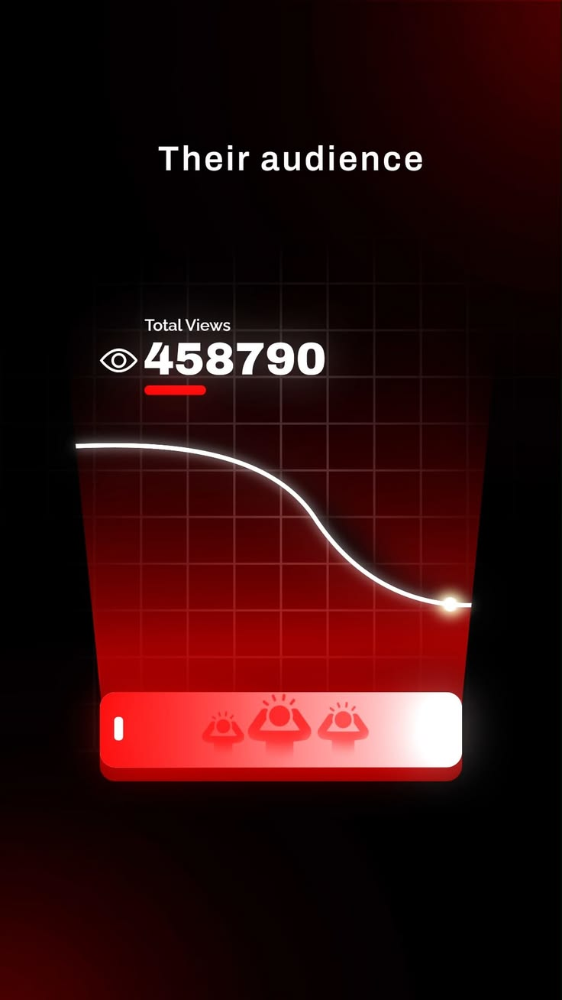

# Motion Graphics branding - After Effects

- **Категория:** `01_business_minimal`
- **Ссылка на Pinterest:** [https://ru.pinterest.com/pin/1128573987891225555/](https://ru.pinterest.com/pin/1128573987891225555/)
- **Скриншот референса:** 

---

## 1. Стилистический разбор
Брендинговая моушн-графика для экспертов и компаний. Минимализм, точная сетка и типографика.

---

## 2. Использование в Remotion / Claude Pipeline
1. **Цветовая палитра и физика:** см. `style_manifest.md` в текущей папке.
2. **Композиция:** вертикальный формат 9:16 (1080x1920 CFR 30 fps), безопасные зоны соблюдены.
3. **Хук (0-3s):** брать визуальную композицию с превью `` для первого кадра.
