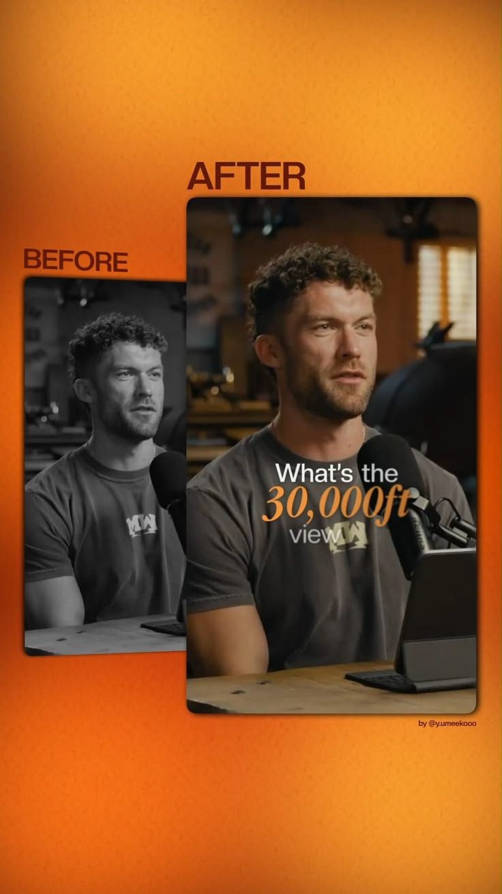

# Референс: Viral talking head motion - Clean Business Layout

- **Категория:** `01_business_minimal`
- **Ссылка на пин Pinterest:** [https://ru.pinterest.com/pin/897412663267269144/](https://ru.pinterest.com/pin/897412663267269144/)
- **Скриншот / Превью:** 

---

## 1. Разбор визуального стиля
Строгий деловой сетап с центрированным спикером, темным градиентным фоном и аккуратными всплывающими текстовыми тезисами.

---

## 2. Ключевые приемы для вертикального видео (9:16)
- **Хук (0–3 сек):** Визуальный акцент сразу притягивает взгляд, отсутствие лишней экспозиции.
- **Динамика:** Синхронизация ключевых текстовых элементов с закадровым голосом.
- **Безопасная зона:** Все графические плашки расположены в пределах безопасной зоны (верх 220px, низ 380px).

---

## 3. Инструкция для Claude при монтаже
При выборе этого референса:
1. Загрузи палитру и параметры из `style_manifest.md` в этой папке.
2. Используй spring-физику Remotion для плавного появления плашек.
3. Сохраняй скриншот `` как визуальный ориентир композиции.
