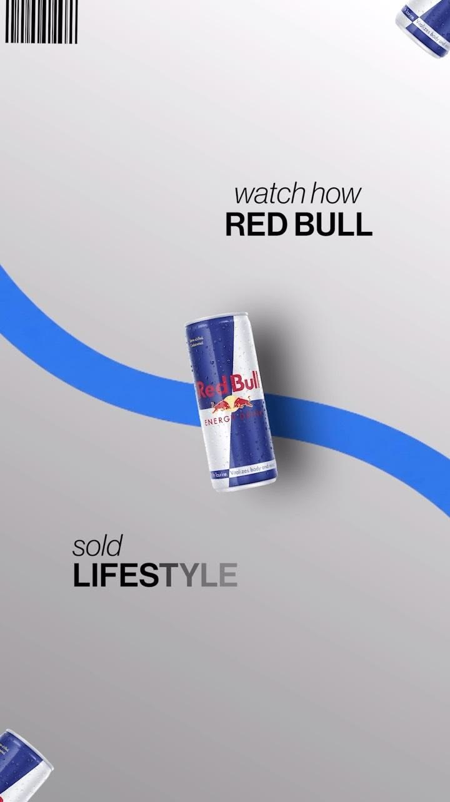

# Референс: Premium Motion Design - Bold Typography, Smooth Transitions & Sound Design

- **Категория:** `04_luxury_dark_aesthetic`
- **Ссылка на пин Pinterest:** [https://ru.pinterest.com/pin/1102537552561443263/](https://ru.pinterest.com/pin/1102537552561443263/)
- **Скриншот / Превью:** 

---

## 1. Разбор визуального стиля
Премиальный моушн-дизайн с бегущими световыми градиентами, широким кернингом и плавной динамикой.

---

## 2. Ключевые приемы для вертикального видео (9:16)
- **Хук (0–3 сек):** Визуальный акцент сразу притягивает взгляд, отсутствие лишней экспозиции.
- **Динамика:** Синхронизация ключевых текстовых элементов с закадровым голосом.
- **Безопасная зона:** Все графические плашки расположены в пределах безопасной зоны (верх 220px, низ 380px).

---

## 3. Инструкция для Claude при монтаже
При выборе этого референса:
1. Загрузи палитру и параметры из `style_manifest.md` в этой папке.
2. Используй spring-физику Remotion для плавного появления плашек.
3. Сохраняй скриншот `` как визуальный ориентир композиции.
