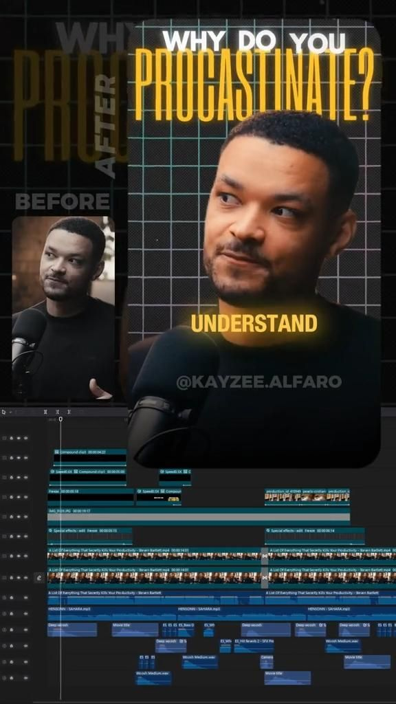

# Turning Boring Podcast to Dope Reels

- **Категория:** `06_podcast_splitscreen_subtitles`
- **Ссылка на Pinterest:** [https://ru.pinterest.com/pin/968836938591263487/](https://ru.pinterest.com/pin/968836938591263487/)
- **Скриншот референса:** 

---

## 1. Стилистический разбор
Трансформация монотонного подкаста в цепляющий клип с инфографикой.

---

## 2. Использование в Remotion / Claude Pipeline
1. **Цветовая палитра и физика:** см. `style_manifest.md` в текущей папке.
2. **Композиция:** вертикальный формат 9:16 (1080x1920 CFR 30 fps), безопасные зоны соблюдены.
3. **Хук (0-3s):** брать визуальную композицию с превью `` для первого кадра.
